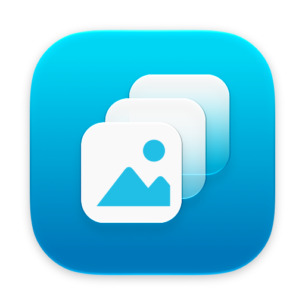

<p align="center"></p>

<h1 align="center">PixelShift</h1>

<p align="center"><em>Shift pixels, reshape possibilities.</em></p>

<p align="center">A fast, native Mac app for resizing photos in batches.<br>
Drop in images or whole folders, and every one is resized, cropped, watermarked or converted the way you set it up.</p>

<p align="center"><a href="https://github.com/RivianTrackr/pixelshift/releases/latest"><strong>Download the latest version</strong></a> · macOS 14 Sonoma or later · Apple Silicon and Intel</p>

---

## Install

1. Download `PixelShift-<version>.zip` from the [latest release](https://github.com/RivianTrackr/pixelshift/releases/latest) and open it.
2. Drag **PixelShift** into your **Applications** folder.
3. Open it. The first time, macOS may say it can't check the app for malicious software, because PixelShift isn't notarized by Apple yet. Click **Done**, open **System Settings → Privacy & Security**, scroll down and click **Open Anyway** next to PixelShift. You only need to do this once.

PixelShift updates itself. Choose **PixelShift → Check for Updates…** at any time, or let it check automatically (it asks the second time you open it; change it later in **PixelShift → Settings…**).

## Use it

- **Drop** images or folders on the window or on the Dock icon, or click **Choose Files…** (⌘O).
- **Right-click** images or folders in Finder and choose **Resize with PixelShift** (under Quick Actions or Services).
- Every image is processed with the settings in the window. Results go to a folder you choose, or next to the originals with a name suffix such as `photo-1200.jpg`.

## Features

- **Resize:** by percent, width, height, fit inside a box, crop to an aspect ratio, or crop then fit. Optionally only ever scale down.
- **Formats:** JPEG, PNG, TIFF and HEIC, with a quality setting, a color space (original, sRGB, Display P3, Adobe RGB) and a fill color for transparent areas.
- **Metadata:** remove all of it, keep all of it (EXIF, IPTC and XMP), or keep everything except location. Add artist and copyright, or set the DPI. Photos are always saved upright.
- **Watermark:** any image, in nine positions or stretched, with offsets from the edge.
- **Folders:** keeps the folder structure, can copy non-image files along, can ask before replacing files, and always warns before saving over the originals.
- **Presets:** save settings as named presets and switch between them with ⌘1–⌘9.
- Uses every core, keeps the Mac awake while it works, and notifies you when a batch is done.

## Privacy

PixelShift runs entirely on your Mac inside Apple's App Sandbox. It only opens the files you give it, collects no data and has no analytics. Its only network request is the update check, which goes to this repository's GitHub Releases.

## Build from source

Requires Xcode 26 or later (the Command Line Tools alone lack SwiftUI's macros and the icon compiler).

```bash
git clone https://github.com/RivianTrackr/pixelshift.git
cd pixelshift
swift test                      # engine tests
scripts/build-app.sh            # build/PixelShift.app (universal, sandboxed)
scripts/build-app.sh --install  # also copy it to /Applications
```

`Sources/ResizeCore` is the resizing engine (ImageIO and Core Graphics, no UI), `Sources/PixelShift` is the SwiftUI app, and `Icon/AppIcon.icon` is the Liquid Glass icon (open it in Icon Composer). Publishing a release is covered in [RELEASING.md](RELEASING.md).

## Feedback

Found a bug or want a feature? [Open an issue](https://github.com/RivianTrackr/pixelshift/issues).

## License

PixelShift is released under the [MIT License](LICENSE). It uses [Sparkle](https://sparkle-project.org) for updates; see [THIRD-PARTY-NOTICES.md](THIRD-PARTY-NOTICES.md).
